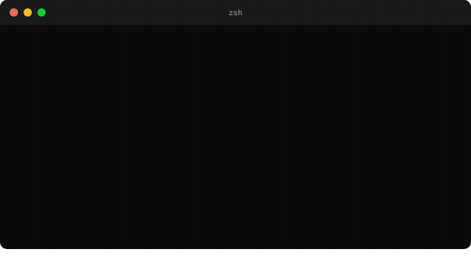

<p align="center">
  
</p>
<p align="center">
  <strong>CLI tool discovery for AI agents</strong>
</p>
<p align="center">
  Search, compare, and install 5,000+ command-line tools with structured YAML/JSON output.
</p>
<p align="center">
  <a href="https://github.com/syshin0116/clidex/actions/workflows/ci.yml"></a>
  <a href="https://github.com/syshin0116/clidex/releases/latest"></a>
  <a href="https://crates.io/crates/clidex"></a>
  <a href="https://github.com/syshin0116/clidex/blob/main/LICENSE"></a>
</p>

---

AI agents like Claude Code, Codex, and Gemini CLI can run any terminal command, but they only know the tools they saw in training. They reach for `grep` when `ripgrep` is faster, or `find` when `fd` is simpler.

Clidex is a local index of command-line tools that agents can query: what each tool does, how to install it on this machine, how to use it, and where its docs are. Lookups run offline against a cached index, so there is no web search, no API key, and no per-query cost.

<p align="center">
  
</p>

## Quickstart

```bash
cargo install clidex     # or: curl -fsSL https://raw.githubusercontent.com/syshin0116/clidex/main/install.sh | sh
clidex update            # download the index (about 330 KB)

clidex "json processor"           # pretty in a terminal, YAML in a pipe
clidex info jq --json             # one tool, every field
clidex compare jq dasel yq        # side by side
```

## Use it from an agent

**MCP server.** Any MCP client can call clidex directly:

```bash
claude mcp add clidex -- clidex mcp
```

```json
{ "mcpServers": { "clidex": { "command": "clidex", "args": ["mcp"] } } }
```

It exposes `search_tools`, `tool_info`, `compare_tools`, `trending_tools`, and `list_categories`. All are read-only and return typed `structuredContent`.

**Agent skill.** Copy [`skills/clidex`](skills/clidex/SKILL.md) into your agent's skills directory (for Claude Code, `~/.claude/skills/`). It tells the agent when to search and to ask before installing.

**Plain CLI.** Request JSON and only the fields you need:

```bash
clidex "convert csv to json" --json --fields name,desc,install,examples -n 3
clidex info ripgrep --json --fields name,install,examples
```

```json
{
  "name": "ripgrep",
  "install": {
    "apk": "apk add ripgrep",
    "brew": "brew install ripgrep",
    "cargo": "cargo install ripgrep",
    "pacman": "pacman -S ripgrep",
    "scoop": "scoop install ripgrep"
  },
  "examples": [
    { "command": "rg {{pattern}}", "description": "Recursively search current directory for a pattern (`regex`)" },
    { "command": "rg {{pattern}} {{path/to/file_or_directory}}", "description": "Recursively search for a pattern in a file or directory" },
    { "command": "rg {{[-F|--fixed-strings]}} -- {{string}}", "description": "Search for a literal string pattern" }
  ]
}
```

Exit codes, the error object on stderr, and the schema versioning policy are in the [output contract](docs/agent-integration.md#output-contract).

## What an entry contains

| Field | Example | Source |
|-------|---------|--------|
| `install` | `brew`, `cargo`, `npm`, `pipx`, `pacman`, `apk`, `scoop` commands | Homebrew, crates.io, npm, PyPI, Repology |
| `examples` | up to three tldr examples, `{{...}}` marks a placeholder | [tldr-pages](https://github.com/tldr-pages/tldr) |
| `stars`, `last_updated` | GitHub stars and last push | GitHub API |
| `brew_installs_365d` | Homebrew installs in the last year | Homebrew analytics |
| `links` | `repo`, `homepage`, `docs`, `llms_txt` | GitHub, crates.io, PyPI, tldr-pages, project sites |

`llms_txt` points to an [llms.txt](https://llmstxt.org/) file an agent can fetch to learn the tool. The full field list is in [`src/model.rs`](src/model.rs).

## Usage

```bash
clidex "file manager" -n 3 --score         # top 3 with relevance scores
clidex search "git diff" --category git    # explicit form, filtered by category
clidex batch "json processor" "git diff"   # several queries, one index load
clidex info ripgrpe                        # typo -> "Did you mean: ripgrep"
clidex trending --updated-since 2026-01-01 # most starred, recently active
clidex categories git                      # category names and counts
clidex --category docker -n 5              # browse a category
clidex stats                               # index size, coverage, schema version
```

Output is pretty on a terminal and YAML in a pipe. `--json`, `--yaml`, and `--pretty` force a format. Common flags work before or after the subcommand.

## Keeping the index fresh

The index is rebuilt every day by [GitHub Actions](.github/workflows/build-index.yml) and published as a [release asset](https://github.com/syshin0116/clidex/releases/tag/index).

- `clidex update` sends the stored ETag, so it only downloads when the index changed, and fetches the zstd-compressed copy.
- Downloads are checked against the published SHA-256. Each build is also attested, so you can verify where an index came from:
  `gh attestation verify ~/.clidex/index.yaml -R syshin0116/clidex`
- Commands print a warning on stderr when the local index is more than 14 days old.
- In an interactive terminal, a missing index is downloaded on first use. Pipes and CI get exit code 3 instead of a silent network call. `clidex mcp` always downloads a missing index, because MCP clients start it without a terminal.

## How search works

BM25 over tool name (3x), tags and category (2x), and description (1x), plus:

- synonym expansion (`grep` also matches `search`, `ripgrep`, `rg`) and alias mapping (`rg` -> ripgrep, `z` -> zoxide)
- bonuses for query-term coverage and matching category names
- a small popularity boost from stars and Homebrew installs, used as a tie-breaker
- typo tolerance through edit distance and subsequence matching
- confidence gates, so nonsense queries return `[]` instead of noise

A search takes a few milliseconds once the engine is built. Each CLI call also loads the index (about 0.25 s), so `batch` and `clidex mcp` are faster for repeated queries.

Builds with `--features semantic` add Model2Vec embeddings fused with BM25. Release binaries leave it out: it nearly doubles the binary (4.4 MB to 7.3 MB) and downloads a model from Hugging Face on first search.

## Data sources

| Source | Provides |
|--------|----------|
| [awesome-cli-apps](https://github.com/agarrharr/awesome-cli-apps), [toolleeo/cli-apps](https://github.com/toolleeo/cli-apps), [modern-unix](https://github.com/ibraheemdev/modern-unix), [awesome-tuis](https://github.com/rothgar/awesome-tuis) | Curated tools and categories |
| [Homebrew](https://formulae.brew.sh/) formulae, casks, and analytics | `brew install` commands, install counts |
| [crates.io](https://crates.io/), [npm](https://www.npmjs.com/), [PyPI](https://pypi.org/) | Discovery plus `cargo`, `npm`, and `pipx` commands |
| [Repology](https://repology.org/) | `pacman`, `apk`, and `scoop` commands for Homebrew formulae |
| [tldr-pages](https://github.com/tldr-pages/tldr) (CC BY 4.0) | Usage examples |
| [GitHub API](https://docs.github.com/en/rest) | Stars, last push, homepage |
| [llms.txt](https://llmstxt.org/) probing | LLM-readable documentation links |

Install commands and examples are attached only when the source can be tied to the same project: npm and crates.io entries must declare a binary and the same repository, Repology projects must contain the same Homebrew formula, and tldr pages must link to the tool's repository or homepage. Coverage is lower as a result, but agents don't get commands for the wrong package.

## Build the index locally

```bash
cargo run --release --features index-builder --bin build_index -- index.yaml [previous-index.yaml]
```

The previous index, when given, supplies cached GitHub and Repology results.

| Variable | Default | Description |
|----------|---------|-------------|
| `CLIDEX_INDEX_PATH` | `~/.clidex/index.yaml` | Index location for every command; the ETag and embeddings live beside it |
| `CLIDEX_NO_STALE_WARNING` | unset | Silence the old-index warning |
| `GITHUB_TOKEN` | unset | GitHub API token (60 to 5,000 requests per hour) |
| `GITHUB_LIMIT`, `CRATES_LIMIT`, `NPM_LIMIT`, `LLMS_LIMIT` | 50, 100, 50, 100 | Per-run request caps |
| `REPOLOGY_LIMIT` | 20 | Repology requests per run, paced at about one per second |
| `TLDR_PAGES_DIR` | unset | Unpacked [`tldr-pages.en.zip`](https://github.com/tldr-pages/tldr/releases/latest/download/tldr-pages.en.zip); examples are skipped without it |

Add `--features semantic` to the builder to also produce embeddings.

## Contributing

Missing tools, poorly ranked results, and new data sources are all welcome. Read [CONTRIBUTING.md](CONTRIBUTING.md) first, use the search quality issue form for ranking problems, and report vulnerabilities as described in [SECURITY.md](SECURITY.md).

```bash
cargo test --all-targets --all-features
cargo clippy --all-targets --all-features -- -D warnings
cargo fmt
```

The minimum supported Rust version is 1.88.

## License

[MIT](LICENSE). Usage examples come from tldr-pages under [CC BY 4.0](https://github.com/tldr-pages/tldr/blob/main/LICENSE.md).
